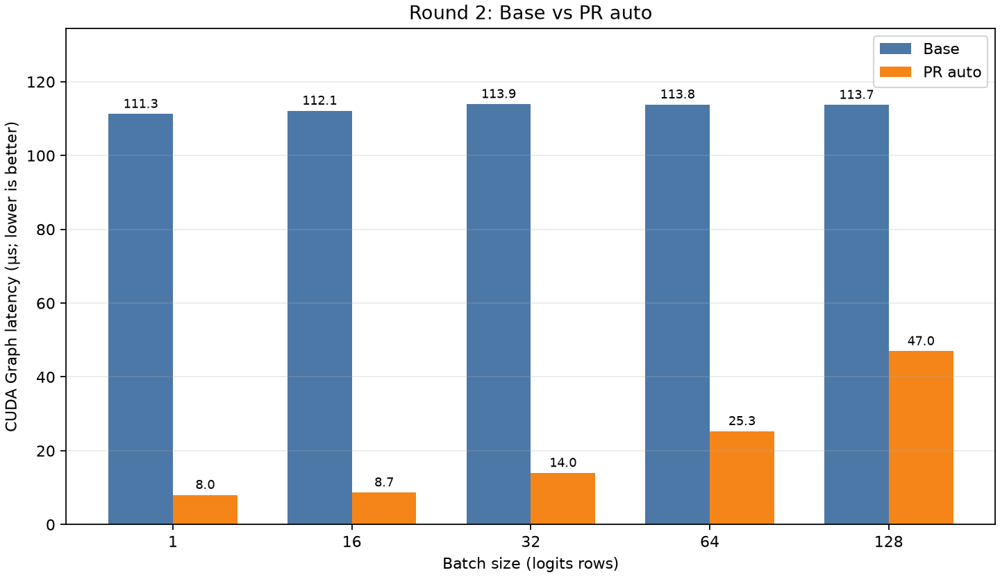
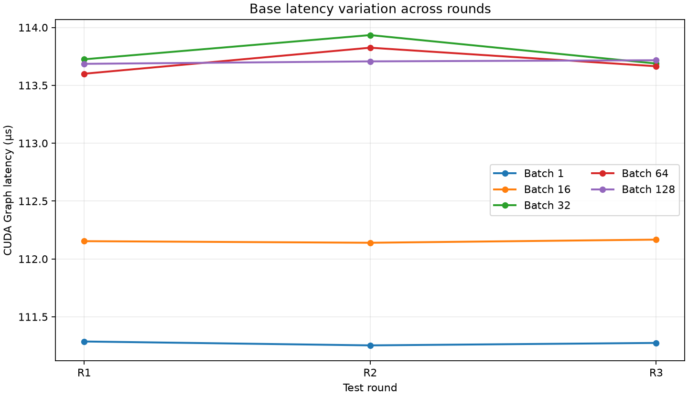
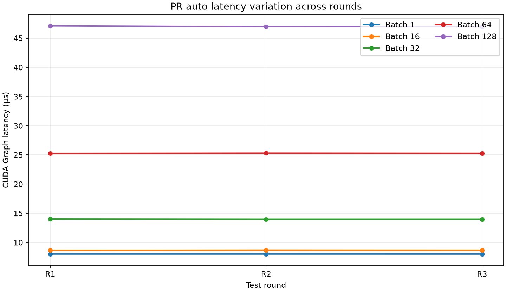

# Independent H200 Reproduction of vLLM PR #60097

**A kernel-level CUDA Graph microbenchmark for token log-probability computation**  
**Run date:** 2026-10-14  
**Status:** Completed; benchmark artifacts are retained alongside this report.

## Abstract

This report documents an independent reproduction of the token-logprob kernel performance comparison associated with [vLLM PR #60097](https://github.com/vllm-project/vllm/pull/60097), which addresses the performance opportunity described in [Issue #60095](https://github.com/vllm-project/vllm/issues/60095). On one NVIDIA H200, the PR implementation using its automatic vocabulary-split selection had lower warmed CUDA Graph latency than the base implementation for all five tested batch sizes (1, 16, 32, 64, and 128). Across three alternating rounds, median speedups ranged from **2.42× to 13.88×**. All benchmark correctness checks passed.

These results apply only to the tested kernel workload and configuration. They do not measure cold-start compilation, model-serving latency, concurrency behavior, or other GPU and workload combinations.

## 1. Goal and scope

Issue #60095 describes an opportunity to reduce token-logprob kernel work by reading each vocabulary row once and by splitting rows across GPU programs for small decode batches. PR #60097 implements an online max/sumexp reduction and an optional split-vocabulary path.

The goal here was to independently compare the pinned base and PR implementations on an H200 using the same benchmark harness, shared compiled-extension root, and workload parameters. This is a microbenchmark of `compute_token_logprobs`; it is not a reproduction of the full vLLM serving workload.

## 2. Implementations and environment

| Item | Value |
|---|---|
| GPU | NVIDIA H200, 132 multiprocessors (SMs), 143,155 MiB reported device memory, 60 MiB L2 cache |
| Base source commit | `d09ff7763747bbe7cd153edd8017479804f47be7` |
| PR source commit | `0ddd6017793c943a2091a5800f0cbac1daaa3e02` |
| Shared compiled-extension checkout | `src/vllm`, pinned at `fbe8a157fbdd4b2f813ae6395397232de97d5c5d` |
| Installed vLLM package | `0.29.1rc1.dev405+gfbe8a157f.precompiled` |
| PyTorch | `2.13.0+cu130` |
| CUDA runtime | `13.0` |
| Triton | `3.7.1` |
| Python | `3.12.3` |
| NVIDIA driver | Not recorded in the benchmark JSON metadata |

The benchmark loaded Python source from the selected base or PR worktree while using the same `src/vllm` checkout as the compiled-extension root for both arms. This kept the compiled binaries constant across the comparison.

## 3. Workload and measurement method

The benchmark used the following fixed workload:

| Parameter | Value |
|---|---|
| Vocabulary size | 151,936 |
| Logit dtype | bfloat16 |
| Number of requested logprobs (`K`) | 6 |
| Batch sizes | 1, 16, 32, 64, 128 |
| PR split mode | `auto` |
| Warmup calls per configuration | 10 |
| CUDA Graph calls captured | 20 |
| CUDA Graph replays measured | 10 |
| Rounds | 3, alternating which arm ran first |

The reported metric is CUDA Graph device time in microseconds per `compute_token_logprobs` call. The harness captured 20 calls in a graph, replayed that graph 10 times, and normalized elapsed CUDA-event time by the total number of calls. The base implementation used its unchanged path; the PR implementation used automatic split selection. The measured PR time therefore includes the PR's selected kernel path, including the split and merge kernels when the heuristic selects them.

For each configuration, the harness compared the output against a float64 `torch.log_softmax` reference gathered at the requested token IDs, using `atol=2e-3` and `rtol=2e-3`. All recorded rows completed with `status=ok` and `correct=true`.

The three-round order was:

1. Round 1: base, then PR.
2. Round 2: PR, then base.
3. Round 3: base, then PR.

Alternating order reduces, but does not eliminate, possible bias from GPU temperature or clock changes.

## 4. Results

The table reports the median of three rounds for each implementation. Min–max values show only the observed three measurements. Speedup is `base median / PR auto median`; values above 1 mean lower measured latency for the PR in this workload.

| Batch size | Base median (µs) | Base min–max (µs) | PR auto median (µs) | PR min–max (µs) | Speedup | PR latency reduction |
|---:|---:|---:|---:|---:|---:|---:|
| 1 | 111.27 | 111.25–111.29 | 8.02 | 8.02–8.02 | 13.88× | 92.8% |
| 16 | 112.15 | 112.14–112.17 | 8.67 | 8.65–8.68 | 12.94× | 92.3% |
| 32 | 113.72 | 113.69–113.93 | 13.98 | 13.98–14.02 | 8.13× | 87.7% |
| 64 | 113.66 | 113.60–113.83 | 25.27 | 25.26–25.29 | 4.50× | 77.8% |
| 128 | 113.71 | 113.69–113.72 | 46.99 | 46.97–47.12 | 2.42× | 58.7% |

All five tested batch sizes showed lower PR auto CUDA Graph latency in each of the three measured rounds. Observed range divided by median was at most 0.22% for base and 0.41% for PR auto. With only three rounds, these ranges are descriptive and should not be interpreted as confidence intervals or a robust estimate of run-to-run variance.

### Figures

**Round 1 comparison**


**Round 2 comparison**



**Round 3 comparison**


**Base variation across rounds**



**PR auto variation across rounds**



## 5. Interpretation

For the tested H200 kernel workload, this independent run reproduced a substantial reduction in warmed CUDA Graph latency for the PR implementation relative to the pinned base. The trend and scale are consistent with the kernel-level H200 results described in the PR discussion, which also report that the PR's automatic split choice can be slower than the best forced split count for some shapes.

This experiment does not establish that the automatic split heuristic is optimal. It compares `auto` with the base implementation, not `auto` against every forced split value. It also does not establish end-to-end application speedup or absence of regressions in cold-start and serving scenarios.

## 6. Limitations

- Only one H200 and one software environment were measured.
- Only one vocabulary size (151,936), one dtype (bfloat16), one logprobs count (`K=6`), and five batch sizes were tested.
- The repeat analysis contains three rounds, which are useful as an initial repeatability check but are insufficient for strong statistical claims.
- The metric is warmed CUDA Graph device time. It excludes Python-side dispatch and does not measure request latency, TTFT, TPOT, throughput, or concurrency.
- Cold-start compilation was not measured under a controlled empty Triton cache. The `first_call_wall_ms` field in benchmark records is not used here as a cold-start result because cache state was not controlled across runs.
- The benchmark artifacts do not record the NVIDIA driver version or the outer `vllm-lab` repository commit. These should be captured in future runs.
- Results on this H200 do not predict the optimal split count or performance on another GPU.

## 7. Reproduction command

From the outer `vllm-lab` repository on the remote Pod, the repeated A/B run was launched with:

```bash
cd /workspace/vllm_lab
VLLM_BINARY_ROOT=/workspace/vllm_lab/src/vllm \
  benchmarks/kernels/issue60095/run_repeated_ab.sh
```

The harness and analysis code are maintained in [`vllm-lab`](https://github.com/RichterWang/vllm-lab/tree/issue60095-cloud-ready). The individual captured run parameters and outputs are retained in the linked reference artifacts below.

## 8. Artifact index

- [Three-round analysis report](data/analysis/report.md)
- [Three-round comparison CSV](data/analysis/comparison.csv)
- [Analysis metadata](data/analysis/analysis.json)
- [Raw repeated-run JSON and CSV files](data/repeated_ab/)
- [Standalone base run](data/standalone/base/)
- [Standalone PR run](data/standalone/pr/)

The `figures/` and `data/` directories are part of this report workspace. All
links above are relative to this report, so the complete `report_worksapce/`
directory can be moved or uploaded as a unit without breaking them.

## Conclusion

On the tested H200 configuration, PR #60097's automatic split path produced lower warmed CUDA Graph latency than the pinned base for all five tested batch sizes, with median speedups from 2.42× to 13.88× across three alternating rounds. This is evidence for the kernel-level result in this specific workload. It is not evidence about cold-start compilation or end-to-end serving behavior.
